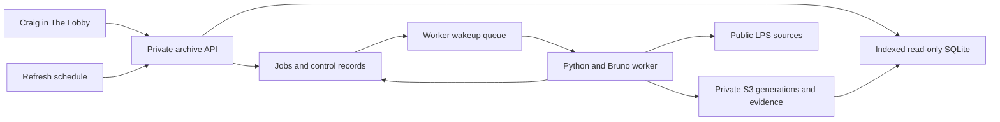

# Soccer archive migration and Lobby operations implementation plan

> **Implementation handoff:** Follow the repository instructions, recheck the source dependencies below, and work through the task checkboxes after implementation is authorized.

**Status:** Proposed on November 4, 2026. Craig authorized publishing and merging this planning document on November 11, 2026. Implementation, cloud changes, collection runs and schedules remain outside that authorization.

**Accepted decision, November 5, 2026:** Craig confirmed admin-only collection and discovery controls first, with visitor-facing archive displays planned afterward. This confirms access and sequencing; the remaining architecture and implementation plan are still proposals.

**Goal:** Preserve the existing Boise archive, make it queryable through a private workspace in The Lobby, and support continued collection and bounded source discovery there. Design visitor-facing `/soccer` displays afterward.

**Architecture:** Keep soccer data and collection logic in the soccer repository. Publish immutable SQLite snapshots and sanitized evidence to private S3, serve indexed queries through a separate archive API, and run the existing Python/Bruno collector in bounded background jobs. The Lobby owns every screen, sign-in and access check.

**Tech stack:** Existing Python collector, SQLite and pinned Bruno CLI; AWS S3, Lambda, SQS FIFO, DynamoDB control records and EventBridge Scheduler; existing Go/Chi and React code in The Lobby; OpenTofu and Task for delivery.

**Spec:** The proposed design and contracts in this document, together with the soccer README, The Lobby's current README/ADRs and `aws-setup/aws-design.md`. This plan proposes extensions to those specifications, not already accepted changes to them.

## Scope and constraints

- Boise only, facility ID `4`.
- Accepted access scope: collection and discovery controls are admin-only, initially Craig. Proposed implementation: a `soccer-archive` Tool grant and private workspace at `/soccer/archive`. The existing `/admin` page belongs to family device configuration.
- Preserve the existing calendar/download/Session-link behavior, Member feeds, Google Calendar event generation and their Go Lambda. Archive failures must not hold up calendar requests.
- Preserve the current public sporting-data retention contract. No coach IDs in responses or logs. Do not import account records, credentials, memberships, player names or booking descriptions through this migration.
- Keep source evidence and observations. Missing scores and missing leaderboard entries remain unknown, not zero. Do not claim complete all-time coverage.
- Team IDs identify registrations in a Session. A matching name is a candidate relationship, not proof of one persistent team.
- Workloads belong in `us-west-2`, with soccer-owned IaC, least-privilege roles, encryption, private buckets, automated recovery copies, lowercase `project` tags and 30-day application logs.
- Follow the existing GitHub Actions deployment process. Bootstrap/role changes and first applies need the specific approval described in the repository's deployment instructions. Production activation and recurring collection are explicit delivery steps.
- Update the owning README when behavior changes. Use Task commands and commit-SHA-pinned Actions. Do not put datasets, credentials, binary infrastructure plans or local state in Git.

## Verified baseline on November 4, 2026

Read-only inspection verified the following on November 4. These are dated local source/data facts, not evidence of a cloud deployment or a fresh November 11 archive inventory. Unless a later date is stated, existing collector and infrastructure behavior described below refers to that inspection. Recheck it before implementation.

| Item | Verified baseline |
| --- | --- |
| Planning baseline | Soccer `efb4d9a`, matching GitHub main at inspection |
| Collector work | Local branch `codex/boise-bruno-collector`, `2491790`; not present on main |
| Installed collector release | `5c6f907f48e2c3076ae6f6a11354f6a22b914205` |
| Durable dataset | `~/Library/Application Support/LPS Boise Collector/data/boise-history` on the operator's Mac |
| Database | `collector.sqlite3`, schema v1, 141,611,008 bytes |
| Whole dataset | 320,939,624 bytes, about 306 MiB |
| Entities | 93,094 games; 23,019 registrations; 104 seasons; 171 division definitions |
| Divisions | 3,784 discovered; 3,782 successful; two failed |
| Historical evidence | 195,683 game observations; 22,994 standing rows; 36,404 leaderboard rows; 9,913 source snapshots |
| Declared interval | January 1, 2010 through November 4, 2026; 6,131 successful dates and 21 invalid dates |
| Observed game dates | April 12, 2010 through November 13, 2026; division responses include 90 games beyond the declared interval |
| Integrity | SQLite integrity check passed; zero foreign-key violations; all 9,913 referenced evidence files present with matching SHA-256 |
| Database SHA-256 | `7183a106bf1d2b812f5cb08379f4826bd1bbab0ed6bc14649380b7cc74c24e4c` |

Every date in the declared interval was attempted. That does not make the interval complete: 21 responses were rejected, two divisions remain unavailable, and the source's historical retention boundary is unresolved. Preserve both `interval_complete=false` and `all_time_complete=false`.

Bruno 4.3.0 already executes the collector's public requests. Python owns validation, the SQLite queue, serial pacing, retries and sanitized evidence. Do not build the previously proposed Bruno bridge again.

The local explorer already supports sessions, divisions, registrations, player IDs, games, coverage, CSV and bounded read-only SQL. Its query semantics are useful, but its implementation eagerly loads the archive and a 39,769,977-byte coverage report. Do not expose that loopback server or copy its full-memory loading path into a public request handler.

The current `refresh` command never refreshes successful **day** resources. Repeating `scan` also skips them. No recurring schedule exists. Continuing population therefore needs a real recent-day refresh operation.

The old portfolio repository has a separate authenticated membership-history implementation with collection disabled in committed environment configuration. It is not this archive and is not a migration source.

Publication recheck on November 11 used soccer main `e0c825f`. Member feeds and Google Calendar event generation have since landed through PRs #20 and #21. Keep both behaviors in the implementation regression checks. The collector remains a separate local branch and must be made available through Task 1 before another checkout can execute the later tasks.

## Proposed design

### Storage and ownership

Use the existing relational archive as the source of truth. A migration to a different database engine is unnecessary at the verified size and would introduce another reconciliation problem before the display requirements are known.

| Component | Responsibility |
| --- | --- |
| Private S3 archive bucket per environment | Immutable database generations, content-addressed sanitized evidence, manifests and audit reports |
| Read-only browse database per generation | Indexed projection of sessions, divisions, registrations, games, participant relationships, current standings/leaders, provenance and compact coverage |
| Archive API Lambda | Named queries, job admission/status and controlled exports; IAM-only Function URL invoked by The Lobby |
| Collector worker Lambda container | Existing Python + pinned Node/Bruno runtime; public source requests, validation, durable journal and generation publication |
| Soccer DynamoDB control table | Job records, idempotency, provider pacing, writer lease, journal indexes and active-generation pointer; not the sporting dataset |
| SQS FIFO and dead-letter queue | Wake the worker for bounded chunks; one provider message group |
| EventBridge Scheduler | Recurring refresh admission and recovery of due jobs whose wakeup was lost; disabled until activation |
| The Lobby | Grant checks, trusted actor identity, private workspace, typed proxy routes and future visitor displays |



The schedule invokes the same job-admission code through an IAM event invocation, not the site's browser route. A separate recovery event checks only due nonterminal jobs and re-enqueues them idempotently.

Publish locally collected data first. That produces a useful read-only milestone while the hosted worker is built and verified. The Mac remains the writer during that milestone. At hosted cutover, stop local collection and make the hosted writer authoritative. Keep the Mac copy for recovery and offline analysis; do not alternate independent writers.

Alternatives considered:

- **Local collector with periodic uploads:** useful first milestone and fallback. It does not satisfy unattended collection controlled entirely from The Lobby.
- **Managed PostgreSQL:** a reasonable later choice if concurrent writes or measured query/refresh costs require it. It adds a database service and an engine migration before the use cases justify them.
- **DynamoDB for every sporting record:** poorly matched to exploratory joins and the existing SQLite archive. Reserve it for small control records.

### Migration contract

The export is an immutable generation with `format_version`, collector schema/release, creation time, facility, declared intervals, observed date bounds, table counts, evidence index, artifact sizes/hashes and limitations. Hosted generations also carry `journal_format_version` and `applied_through_sequence`, the last contiguous journal sequence incorporated into that database. The initial imported archive starts at sequence zero. Generation IDs are opaque; source IDs keep their existing meaning.

1. Acquire the existing dataset lock and create a coherent SQLite backup. Do not copy a live database file without its journal/WAL guarantees.
2. Preserve the complete database, evidence and reports. Exclude runtime credentials, locks, Bruno environments, temporary reporter files and unrelated validation captures.
3. Verify every referenced evidence hash and SQLite integrity. Produce the manifest from that same snapshot.
4. Upload into a new staging generation. A repeated import with the same manifest hash is a no-op; a mismatch cannot replace an existing generation.
5. Build the browse projection from the snapshot, preserving source IDs, nulls, cross-division/cross-session participants and provenance.
6. Read back uploaded objects, verify hashes/counts, and run parity queries. Mark the generation eligible only after validation passes.
7. Atomically change the active-generation pointer. Incomplete uploads are never visible to readers.

Keep the original baseline and accepted evidence. Retain the latest seven replaceable full working checkpoints plus the migration baseline and one daily recovery checkpoint for 30 days. Evidence and manifests referenced by retained history are not deleted by checkpoint expiry. No automatic deletion of irreplaceable observations is part of this plan. Lifecycle policies must distinguish checkpoint artifacts from evidence.

Rollback stops job admission, waits for the active writer to stop, and restores a verified generation pointer. Retain newer generations/journal entries for reconciliation; do not delete accepted observations or silently resume an old writer over a newer archive.

### Query contract

The Lobby calls explicit archive routes, not an unrestricted proxy. The archive API has a separate backend URL so calendar traffic retains its current code path.

| Method and backend path | Contract |
| --- | --- |
| `GET /archive/status` | Active generation, counts, coverage/freshness summary, safe collection health |
| `GET /archive/queries` | Named queries and their typed filters |
| `POST /archive/query` | `{query, filters, cursor, limit, generation}`; read-only results with source/as-of metadata |
| `GET /archive/jobs` | Recent jobs with bounded pagination |
| `POST /archive/jobs/preview` | Validate a named operation; return selected-resource count, request budget and exclusions |
| `POST /archive/jobs` | Enqueue that operation with an idempotency key; return `202` and a job ID |
| `GET /archive/jobs/{jobID}` | Progress, durable checkpoint, retry time and safe failure category |
| `POST /archive/jobs/{jobID}/cancel` | Record cancellation; stop starting requests and retain committed work |
| `POST /archive/jobs/{jobID}/resume` | Resume remaining eligible work; optionally add an explicitly previewed request budget without resetting spent attempts |

Suggested request and response shapes, to be frozen as shared JSON fixtures before coding the proxy:

```json
{"query":"games","filters":{"team_id":"492184","from":"2026-11-01","to":"2026-11-30"},"limit":100}
```

```json
{"generation":"g1","as_of":"2026-11-05T00:00:00Z","rows":[],"next_cursor":null,"coverage":{"all_time_complete":false},"warnings":[]}
```

```json
{"operation":"refresh_recent","parameters":{"through":"2026-11-04"},"request_budget":100,"idempotency_key":"operator-generated-unique-key"}
```

Limits: 100 rows by default, 500 maximum, 1 MiB response, 64 KiB per cell, two-second SQL execution budget. Query cursors include generation and sort position. Reject a cursor paired with a different generation; keep existing reader files open until in-flight queries finish. The first request selects a generation and later pages stay on it.

Initial named queries:

- `coverage_gaps`: requested/attempted/successful/invalid/missing/blocked dates and failed divisions, with retry history.
- `games`: date, field, registration, division and Session filters; scored/unscored status; both participants count for crossovers.
- `registrations`: name/ID, Session and division. Show same-name candidates separately.
- `standings`: official snapshot, source time and scoring rules, with score-derived audits as a separate query.
- `leader_entries`: supplied player-ID entries with publication limitations. Label totals as recorded entries, not careers or appearances.
- `observations`: observations and disagreements for one game, including source kind and fetch time.
- `discovery_candidates`: public catalog/search discoveries, provenance and whether detail has been fetched.
- `source_quality`: suspect dates, source/derived result disagreements, unknown timing and recoverable known values.

CSV exports use the same query limits and escape formula-like cells. Reuse the existing local bounded SQL tool for deeper ad hoc analysis. Arbitrary SQL in the hosted workspace can be a separate addition if the named queries prove insufficient; no arbitrary source URLs, request bodies or shell commands enter the worker.

### Continued population

Proposed defaults are deliberately bounded and configurable in source-controlled policy:

| Operation | Selection and cadence |
| --- | --- |
| Daily refresh | At 04:00 America/Boise, re-fetch the previous seven days and next 21 days, plus the upcoming catalog; enqueue changed/discovered divisions |
| Active division refresh | Include divisions with games in that window and catalog-discovered upcoming divisions, including those with no games yet; at most once per 24 hours unless Craig explicitly requests it |
| Session closeout | Weekly, refresh divisions whose last known game falls in the previous 30 days, respecting their last successful fetch time |
| Historical reconciliation | Weekly, rotate through at most 25 eligible old successful divisions, oldest refresh first; never invoke an unbounded whole-history refresh |
| Historical discovery | Craig chooses an explicit date interval, at most 31 days per submitted operation; follow only divisions actually discovered there |
| Selected retry | Explicit selection of failed/invalid resources after showing prior failure reasons; no blanket reset |

A logical daily run has a default 100-request budget, including discovered divisions. Surface unfinished work and resume it in later chunks within that budget; require a new budget extension when exhausted. A scheduler occurrence coalesces with an equivalent active job rather than creating a duplicate. Do not carry an unlimited growing queue under a label of success.

For a budget-paused job, preview accepts `operation: "resume"`, `job_id` and `additional_request_budget`. Resume accepts that positive increment, at most 100 requests per action, plus an idempotency key. Record the old total, added amount and actor atomically; preserve spent attempts. Replaying the same extension cannot add budget twice. Without an increment, an exhausted job remains paused with a clear reason. The scheduler never increases a job's budget.

Retain serial minimum one-second spacing and upstream `Retry-After`. Rate limiting is global across all hosted jobs. Dev uses synthetic fixtures by default; any bounded live validation must coordinate with the production writer. Local collection must be stopped before the hosted schedule starts.

States are `queued`, `running`, `waiting`, `paused`, `completed`, `completed_with_gaps`, `cancelled`, and `failed`. `waiting` has a retry time; `paused` records budget exhaustion or an operator pause. Known invalid records remain visible and result in `completed_with_gaps`, never a false clean completion.

### Hosted worker durability

The existing collector commits every request to local SQLite. Lambda temporary storage cannot replace that durable disk. Merely uploading SQLite at the end of an invocation would weaken the existing contract.

- Add deadline/cancellation hooks to `collect()` and a remaining-time bound to Bruno subprocess execution. Start with eight minutes of collection in a 15-minute invocation, leaving the remainder for replay, snapshot and publication. Tune from measurements.
- Before each public request, durably reserve an attempt ID and its budget charge. Keep the provider's next-request time/backoff in the control table. Every path, including manual jobs and retries, uses the same provider lease.
- After validation, upload sanitized evidence and a journal event containing the safe outcome/provenance. Each reserved attempt has a monotonic sequence and immutable attempt/event IDs. Mark that attempt recoverable before starting another request. Every sequence gets a terminal outcome, including interrupted/invalid attempts; replay cannot jump over an unresolved gap.
- Replay events strictly after the generation's `applied_through_sequence` in sequence order. A schema migration adds an applied-event ledger whose unique event/attempt keys prevent duplicate observations. Advance the ledger, normalized rows and local replay checkpoint in one SQLite transaction. Retain journal data needed to restore every retained checkpoint, including events already represented in a newer published generation.
- A crash between the upstream response and durable journal completion is an interrupted attempt, not a success. Repeating a public GET may be necessary; charge it against the budget and preserve the uncertainty. Do not promise exactly-once upstream requests.
- Use a fenced writer lease. Its takeover time must be beyond the old invocation's hard deadline and transport margin, so a replacement cannot start while an older worker can still call the provider. TTL deletion is not the lease clock.
- Upload evidence and immutable database/projection/manifest artifacts before publishing. One conditional DynamoDB transaction checks the base generation and fencing token, advances the active generation and records the job checkpoint. A stale worker cannot publish.
- SQS messages carry job IDs, not bodies or credentials. Duplicate delivery is a normal case. A durable queued/waiting job survives a lost enqueue; the recovery event re-enqueues due jobs. Cancellation is checked before each wait/request and before publication.
- Split compact per-chunk SQL summaries from the existing full evidence audit. `report.write_report()` currently reads every evidence file; it must not run at the end of every cloud chunk. Full audits stream bounded partitions and checkpoint their progress.

The SQLite worker can load its last database checkpoint plus newer journal events. Historical evidence downloads are unnecessary for normal normalization. Evidence audits remain a separate operation. Avoid copying the complete database after every request.

### Further discovery and enrichment

Do these after migration parity is proven, so enrichment cannot hide a migration defect.

| Order | Work | Evidence and interpretation |
| --- | --- | --- |
| 1 | Expose already retained metadata and a provenance-aware known-value view | 9,422 games have one consistent earlier nonnull slot end missing from the latest row. Keep the latest source row; expose the known value and its contributing observations separately. Conflicting earlier values remain unresolved. |
| 2 | Refresh recent game results and related standings/leaders | The November 4 investigation found later results for 18 games. This is ordinary freshness work. |
| 3 | Enable catalog discovery and normalize its nested season/division metadata | The inspected catalog had 13 divisions, nine absent from the archive. These are inventory candidates, not nine proven missing historical competitions. The current archive contains zero catalog snapshots. |
| 4 | Add public classification and facility snapshots | `/divisions/league_types`, `/facilities/4`, and the upcoming catalog. Preserve source date, category and facility provenance. Current hours are not historical hours. |
| 5 | Add versioned official rules documents | `/main_pages/rules_document`; retain content hash, fetch time and document metadata. Do not apply today's rules to old Sessions automatically. |
| 6 | Supplemental public team search | Use explicit names/prefixes to discover registrations and their returned divisions. No guessed ID enumeration or assumption that matching names establish identity. |

Preserve suspect source metadata such as Session 175's reported 1926–1927 season dates. Flag it and use observed game dates for browsing; do not silently add a century.

Keep authenticated account-visible registrations/memberships, public player display names, and non-game booking details as separate scope/retention decisions. Existing sanitization discarded those fields; hashes cannot reconstruct them. Neither roster membership nor an upcoming game proves attendance.

### Performance, cost and recovery gates

The Lobby currently has an eight-second request deadline and a seven-second backend client timeout. Job admission must return promptly. Query cold-start/download time is unmeasured, so this plan does not promise interactive latency from the full 135 MiB database.

Build a compact indexed browse projection, download it once per generation per warm environment, verify the hash and atomically switch local files. Measure representative cold and warm queries. Acceptance targets are job admission within one second after initialization, warm queries within one second, and a complete cold query response within five seconds. Treat those as targets, not measured results. If the projection cannot meet them, resolve that before connecting the hosted UI; do not extend every site's request timeout.

Use on-demand compute, S3 Standard initially and on-demand DynamoDB control capacity. Avoid a database server, provisioned compute and a NAT Gateway in the initial design. Costs include Lambda runtime while Bruno starts/waits, retained full database generations, S3 requests, queue/control requests, ECR images, logs and alarms. Many small evidence files and repeated full snapshots can matter more than the initial dataset size. Do not describe this as free.

Before activation, measure a bounded refresh and derive a monthly estimate from actual duration, memory, requests, generation size and retention. Include regional prices from the [Lambda](https://aws.amazon.com/lambda/pricing/), [S3](https://aws.amazon.com/s3/pricing/), [DynamoDB](https://aws.amazon.com/dynamodb/pricing/) and [SQS](https://aws.amazon.com/sqs/pricing/) pricing pages. Present the estimate with the specific infrastructure plan and proposed schedule; no spend limit has been accepted yet.

Automated generation retention, denied runtime deletion of evidence, a retained baseline and a verified restore procedure cover archive recovery. Back up the control table for operational recovery; archive manifests and journal data must also permit reconstruction if control state is lost. Alert on failed publication, repeated worker failures, stale successful refresh and dead-lettered jobs. Logs contain job IDs and error categories, never search text, raw upstream payloads or credentials.

## Implementation sequence

Each task is a separate reviewable deliverable. Proposed files below do not exist yet unless identified as existing. Use fresh branches from current main at execution time and preserve the collector branch as the source until its integration is verified.

### Task 1: Integrate and freeze the existing collector baseline

**Files:** Port the authored `scripts/boise_collect/` package, its tests, required `Taskfile.yaml` entries and ignore rules from `codex/boise-bruno-collector`; retain its operations/research documentation. Update `README.md` with the local archive capability.

**Produces:** The current collector/explorer reproducible from main, with no archive behavior or data-format change.

- [ ] Review the branch diff against current main and the installed release. Separate collector/runtime changes from research-only commits; do not blindly replace current Taskfile or dependencies.
- [ ] Bring over the pinned runtime setup and existing test fixtures. Confirm the test tasks do not perform live collection.
- [ ] Run `task collector:setup`, `task collector:test`, `task explorer:test`, `task ci` and `task lambda` in the execution checkout.
- [ ] Record the exact source release and a fresh aggregate-only inventory. The counts above are a baseline, not a forever-fixed production assertion.
- [ ] Commit the task-owned changes as `feat: integrate the Boise archive collector`.

### Task 2: Build a verified portable generation

**Files:** Create `scripts/boise_collect/publication.py` and `tests/test_publication.py`; extend existing `__main__.py`, `store.py` only where needed for safe backup, and `Taskfile.yaml`; create `docs/operations/archive-migration.md`.

**Interface:** `export_generation(source_dir, output_dir) -> manifest_path`; `verify_generation(manifest_path) -> verification_result`. Neither function calls LPS or publishes anything.

- [ ] Add tests for a writer-held lock, SQLite backup consistency, missing evidence, altered hash, wrong facility/schema, repeated identical export and conflicting generation content. Start with failures before implementation.
- [ ] Implement the manifest, locked backup, evidence inventory and immutable output layout described above.
- [ ] Add `task archive:export -- --data-dir <absolute-source> --output <absolute-output>` and `task archive:verify -- --manifest <absolute-manifest>` wrappers. Keep outputs outside tracked source.
- [ ] Verify the real archive export against the locked source and compare every table count, interval, failure category and evidence hash. Query exact ID sets, not counts alone.
- [ ] Commit as `feat: export verified soccer archive generations`.

### Task 3: Build the query projection and local API contract

**Files:** Create `scripts/boise_collect/projection.py`, `archive_queries.py`, `query_lambda.py`, focused tests and `tests/fixtures/archive_contract/`; adapt `explorer_data.py` to share semantics without retaining eager whole-archive loading in the hosted path. Extend Taskfile and README.

**Interfaces:** `build_projection(source_db, output_db) -> projection_summary`; `run_named_query(connection, query, filters, cursor, limit) -> result`. Query/event handlers accept the JSON contracts above and return bounded JSON.

- [ ] Freeze request/result/error fixtures. Test invalid filters, injection-like search text, limits, nulls, stale cursors and generation consistency.
- [ ] Build indexed projections with a distinct game-participant relation for both teams, their divisions and Sessions. A game crossing Sessions appears in either Session filter and once in global totals.
- [ ] Test parity with existing explorer queries for all named operations, including official standings versus derived results, unavailable divisions and leaderboard suppression.
- [ ] Benchmark the real projected artifact locally and record its size and peak memory. Add `task archive:test` for synthetic tests and a separate explicit benchmark task that reads the local archive only.
- [ ] Commit as `feat: add bounded soccer archive queries`.

### Task 4: Publish and serve an archive in dev

**Files:** Create `scripts/boise_collect/cloud_store.py`, archive API packaging and `infra/archive.tf` with offline tests; extend `infra/bootstrap/deployers.tf`, outputs/variables, `Taskfile.yaml`, `.github/workflows/ci.yml`, `.github/workflows/deploy.yml` and deployment documentation. Update the owning AWS design/permission descriptions.

**Produces:** An authenticated dev archive API serving one verified generation. Collection remains disabled.

- [ ] Add mock-provider tests for private/versioned storage, reader-only data permissions, environment isolation, IAM-only Function URL, deletion protection and deployment-role limits. Create roles/boundaries through the established bootstrap process, with a concrete reviewed plan.
- [ ] Implement generation upload/readback and a conditional active-pointer switch. Use an explicit data-import job in the approved delivery workflow.
- [ ] Prepare the one-time transfer of the Mac export into private staging. Proposed mechanism: `task archive:stage` uses a short-lived Identity Center session for an importer role restricted to new objects under one staging prefix, with no active-pointer, delete or infrastructure permissions. It uploads the manifest last and reports only generation ID, hashes and counts. Then manually dispatch the GitHub Actions import job with that generation ID; the runner validates staged objects before it can activate them. The 306 MiB dataset never enters Git or public workflow artifacts. This local data-transfer exception requires Craig's specific approval and a corresponding runbook/guardrail update because the current repository instructions permit AWS changes through Actions only. Preparing the uploader does not authorize running it.
- [ ] Test lost upload, corrupt artifact, pointer conflict and rollback. Readers continue serving the last verified generation.
- [ ] After the required deployment/data-import approvals, import the frozen generation into dev, run parity checks and measure cold/warm API timing inside the actual site's deadline.
- [ ] Commit as `feat: host verified soccer archive snapshots`; retain the import and benchmark evidence outside Git when it contains dataset content.

### Task 5: Add durable hosted collection and refresh policy

**Files:** Create `scripts/boise_collect/cloud_worker.py`, `cloud_state.py` and focused tests; modify `collector.py`, `bruno_client.py`, `store.py`, `report.py`, `__main__.py`; add a forward-only schema migration for the applied-event ledger and update supported-schema checks in readers. Extend archive infrastructure and Taskfile.

**Interfaces:** Job admission, preview, status, cancel/resume and journal events as specified above. `collect()` gains deadline/cancellation and attempt-journal hooks while retaining the local CLI behavior.

- [ ] Add a regression test proving the old implementation skips a successful recent day. Add coverage for later scores, changed schedules and newly discovered divisions; implement explicit day refresh.
- [ ] Implement bounded selection for each operation, fixed budgets, durable admission/idempotency, provider lease/backoff and job progress.
- [ ] Implement journal write/replay and conditional checkpoint publication. Kill a test worker before request, after response, after journal write, after database upload and after pointer publication; restart and assert the specified recovery result. Restore an older generation while newer events already exist and verify ordered replay without duplicate observations or lost updates.
- [ ] Exercise duplicate SQS delivery, lost enqueue, expired lease/stale publisher, cancellation, budget exhaustion, duplicate budget extensions, 429 Retry-After and generation conflicts. Resume must retain completed observations and spent attempts; only the explicitly added increment can extend the budget.
- [ ] Separate compact summaries from full audits. Verify normal worker chunks do not load the 40 MiB report or all historical evidence.
- [ ] Package the pinned Python/Node/Bruno worker; run offline suites and build checks. Only after authorization, run one bounded dev validation against public sources and measure the operating cost inputs.
- [ ] Commit as `feat: run resumable archive collection jobs`.

### Task 6: Add the private workspace in The Lobby

**Files in the-lobby:** Extend `internal/soccer/soccer.go` and tests or place archive-specific handlers in `internal/soccer/archive.go`; wire `internal/app/app.go`; update `internal/web/web.go`, `internal/web/ui.go`, `web/src/main.tsx`, `web/src/entry-server.tsx`, `web/scripts/prerender.mjs`, `web/src/tools.ts`; create `web/src/soccer/archive/` screens and tests. Add archive backend configuration and update README/ADRs to describe new soccer-owned archive storage while preserving ADR 0011's Member-data ownership.

**Consumes:** Frozen archive JSON fixtures and the separate archive API URL. Reuse `Tool.Check`, the Foundry access pattern and SigV4 signing. Keep Member identity server-derived.

- [ ] Inspect the Member-access check and UI wiring delivered by The Lobby PRs #58/#59, then add `/soccer/archive` to the allowed sign-in returns and a private Tool card. Reuse the shared access machinery while requiring the distinct `soccer-archive` grant for every archive page/API/action request.
- [ ] Build Coverage, Explore, Collect and Runs views. Explore offers the named queries and filters; Collect previews the exact operation and budget; Runs shows durable progress, gaps and retry times.
- [ ] Proxy only allowed routes. Browser-supplied actor headers are ignored. Enforce same-origin mutation checks and recheck grants for each request, including after revocation while a page is open.
- [ ] Test signed-out access, missing/revoked grant, unavailable grant store, forged identity, cross-origin mutation, duplicate submissions, backend timeout and polling through completion/cancellation.
- [ ] Run The Lobby's `task ci` and browser verification against synthetic jobs, then the approved dev backend. Confirm calendar downloads, Session links, Member feeds and Google Calendar event generation still work.
- [ ] Commit as `feat: add a private soccer archive workspace`.

### Task 7: Add discovery sources and source-aware enrichment

**Files:** Extend `model.py`, `store.py`, `collector.py`, `projection.py`, `archive_queries.py`, the versioned schema migrations and existing `bruno/` request definitions; add source fixtures/tests and update README/runbooks.

**Produces:** The ordered public discovery/enrichment work above, with explicit provenance and retained null/quality semantics.

- [ ] First add known-value views from existing evidence; test one consistent earlier value, multiple conflicting values, a later explicit value, and no recoverable value.
- [ ] Add catalog normalization and discovered-division queuing. Test a division with no games, duplicate discoveries, sparse later metadata and suspect source dates. A sparse record must not silently erase a richer known-value view.
- [ ] Add bounded public classification/facility/document operations. New resource kinds need a schema migration because v1 restricts kinds to `day`, `division`, `catalog`.
- [ ] Test document type/size/hash validation, version changes, source failure preserving last good data, and public search discovering only returned IDs.
- [ ] Update preview/query fixtures and The Lobby selectors. Run the collector/archive suites and both repositories' relevant CI gates.
- [ ] Commit independently reviewable source additions, beginning with `feat: preserve source-aware archive metadata`.

### Task 8: Cut over, enable refresh and hand off to display design

**Files:** Finalize `docs/operations/archive-migration.md`, `docs/operations/deploy.md`, README, infrastructure schedule policy and both repositories' acceptance evidence.

- [ ] Review the exact production infrastructure/data-import plan, measured cost estimate, grant assignment and schedule. Apply only through the authorized deployment/bootstrap path.
- [ ] Stop local collection and hold the dataset lock before reconciling the Mac archive against the migration baseline. Export the final coherent generation while the writer is frozen, import it and rerun parity. Keep collection frozen through the verified authority switch; if cutover fails, explicitly resume the local writer and invalidate that pending cutover export.
- [ ] Verify the hosted writer lease, last-good generation and archive query results. Release the local lock only after the hosted writer is authoritative, leaving local collection disabled. Enable the proposed recurring policy only after the next acceptance checks pass.
- [ ] Run an approved bounded refresh from The Lobby. Verify a changed public record, retained prior observation, durable retry state, visible gaps and a restore to a separate verification target. Cancel/resume a synthetic job without losing accepted records.
- [ ] Enable the agreed schedule and verify its configured next occurrence, then follow its first execution through completion or an explained failure. Do not call a configured schedule proven until a run succeeds.
- [ ] Produce a small display-design brief listing reliable queries, coverage labels, representative result shapes and remaining quality limits. Candidate later displays include team Session histories, results/standings, opponent comparisons and schedule trends. Player career claims and automatic cross-Session team identity remain excluded without additional evidence/design.

## Definition of done for this implementation scope

- The frozen archive is migrated with matching source ID sets, snapshots and evidence hashes; known failures remain represented.
- Craig can explore the archive and submit/preview/cancel/resume bounded jobs from The Lobby with correct authorization.
- Recent-day refresh actually revisits successful dates, preserves observations and updates affected divisions.
- Discovery finds public resources with provenance and supports sparse/empty new divisions without inventing completeness.
- Interrupted/duplicate jobs resume safely; provider backoff, budgets and publication survive worker loss.
- The accepted recurring schedule has completed a verified run; recovery has been exercised.
- Existing `/soccer` calendar behavior passes its gates. Visitor-facing archive design is ready to begin as a separate task.

## Evidence and execution references

- Collector inventory: `docs/research/archive-data-inventory-2026-11-04.md` at local branch `codex/boise-bruno-collector`, commit `2491790`. It is unpublished source evidence, not a fetchable main-branch dependency. Task 1 must integrate that authored source and its documentation before implementation continues; obtain it from the operator if the local branch is unavailable.
- Collector runbooks at that same commit: `docs/operations/boise-collector.md`, `docs/operations/boise-collector-local-setup.md`, `docs/operations/boise-explorer.md` and `docs/operations/boise-collector-2026-11-04-validation.md`.
- The Lobby baseline was `f5e0730`; GitHub main was `e0ed9be` on November 4. The inspected app wiring matched that remote blob. On November 11, [issue #52](https://github.com/CraigDevJohnson/the-lobby/issues/52) and [issue #53](https://github.com/CraigDevJohnson/the-lobby/issues/53) were closed/completed by merged [PR #59](https://github.com/CraigDevJohnson/the-lobby/pull/59) and [PR #58](https://github.com/CraigDevJohnson/the-lobby/pull/58), respectively, with no issue comments. These are merged dependencies, not pending work or proof of a live deployment.
- [Accepted ADR 0011](https://github.com/CraigDevJohnson/the-lobby/blob/2b105ac31c1f6b419e340af093a552844ea9b60f/docs/adr/0011-member-soccer-calendar-in-the-site-table.md) keeps Member-specific `soccer#`, `soccerlink#` and `google#` records in the site's table. It does not assign this public archive to that table. [ADR 0007](https://github.com/CraigDevJohnson/the-lobby/blob/2b105ac31c1f6b419e340af093a552844ea9b60f/docs/adr/0007-connected-calendar-writes-into-member-chosen-calendar.md) keeps Google access and writes in The Lobby; soccer supplies event bodies. Both were rechecked at The Lobby main `2b105ac` on November 11.
- [AWS guardrails](https://github.com/CraigDevJohnson/aws-setup/blob/main/aws-design.md) were read from the private repository on November 4. The soccer role was logs-only at that baseline, so new archive access requires reviewed role/boundary changes. Recheck the owning configuration before preparing the infrastructure plan.
- AWS documents [Lambda's temporary storage](https://docs.aws.amazon.com/lambda/latest/dg/configuration-ephemeral-storage.html), [invocation limits](https://docs.aws.amazon.com/lambda/latest/dg/gettingstarted-limits.html) and [SQS delivery behavior](https://docs.aws.amazon.com/lambda/latest/dg/with-sqs.html). These support the bounded-worker design; they do not prove this application's performance or recovery implementation.

The November 4 planning pass did not run collection, modify the archive, publish code, create cloud resources or enable a schedule. Its baseline came from data integrity checks and source inspection. The November 11 publication changes documentation only; validation for the published revision is recorded in its pull request.
